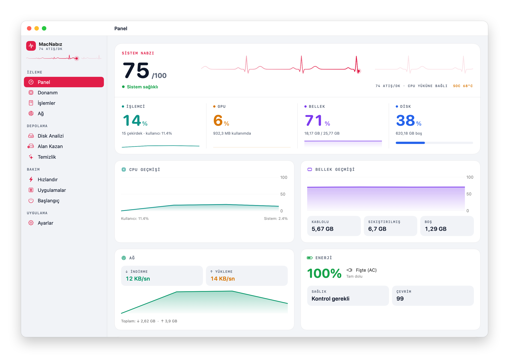

<div align="center">


# MacNabız

**Mac'inin nabzını tutan, yerel ve hafif sistem monitörü.**<br>
CPU, GPU, bellek, disk, ağ, pil ve sıcaklığı canlı izler; diskte neyin yer kapladığını saniyeler içinde bulur ve güvenle temizler.

<p>
  
  
  
  
  
</p>

</div>

<picture>
  <source media="(prefers-color-scheme: dark)" srcset="docs/screenshot-dark.png">
  
</picture>

## Neden MacNabız

- **Bir bakışta durum.** Panelin tepesindeki EKG çizgisi CPU yüküne göre hızlanır; altındaki dört kanal (işlemci, GPU, bellek, disk) son bir dakikanın geçmişiyle birlikte görünür.
- **Disk taraması saniyeler sürer.** 290 GB / 2 milyon dosyalık bir ev klasörü **24 saniyede** taranır (aynı klasörde `du`: 104 sn). Klasörler, en büyük dosyalar ve yinelenen adayları tek geçişte çıkar.
- **Neyin silinebileceğini söyler.** "Alan Kazan" sayfası `node_modules`, `bin/obj`, paket önbellekleri, eski iOS simülatör runtime'ları gibi yeniden üretilebilir alanları **proje adıyla** listeler ve her kalemi "Güvenli" ya da "Kontrol et" diye etiketler.
- **Hiçbir şey dışarı çıkmaz.** Uygulama ağa bağlanmaz, telemetri göndermez; tüm ölçümler yerel sistem API'lerinden okunur.

## Özellikler

| | Bölüm | Ne yapar |
|---|---|---|
| **İzleme** | Panel | Sağlık skoru, CPU'ya bağlı canlı nabız çizgisi, CPU / GPU / bellek / disk kanalları, ağ hızı, pil, sıcaklık ve fan, en çok kaynak kullanan işlemler |
| | Donanım | Çip, P+E çekirdek yapısı, GPU çekirdek ve bellek bilgisi, model, macOS sürümü, Bluetooth cihaz pilleri |
| | İşlemler | Aranabilir, sıralanabilir işlem tablosu; kapat / zorla kapat |
| | Ağ | Uygulama bazında canlı indirme / yükleme hızı |
| **Depolama** | Disk Analizi | Paralel tarayıcı, canlı ilerleme, treemap haritası ve klasöre inme, en büyük dosyalar, yinelenen dosyalar; sağ tıkla Finder'da göster / yolu kopyala / çöpe taşı |
| | Alan Kazan | Proje derleme çıktıları, geliştirici önbellekleri (NuGet, npm, pnpm, Gradle, CocoaPods…), simülatör runtime'ları, Xcode DerivedData, Android SDK, aerial duvar kağıtları, eski indirmeler |
| | Temizlik | Önbellek, log, DerivedData ve çöp kutusu; silinecek her öğenin dökümüyle |
| **Bakım** | Hızlandır | İnaktif belleği boşaltma ve seçili arka plan uygulamalarını kapatma |
| | Uygulamalar | Uygulamayı artık dosyalarıyla birlikte çöpe taşıyan kaldırıcı |
| | Başlangıç | Girişte aç ayarı ve kullanıcı LaunchAgent'ları |
| **Her yerde** | Menü çubuğu | Canlı mini grafik, özet değerler ve hızlı eylemler |
| | Ayarlar | Eşik bildirimleri (CPU, RAM, disk, sıcaklık) ve haftalık otomatik bakım |

## Güvenlik ilkeleri

MacNabız dosya silebilen bir araç; bu yüzden şu kurallara göre çalışır:

1. **Önce göster, sonra sor.** Silinecek her şey adı, yolu ve boyutuyla listelenir; işlem onay olmadan başlamaz.
2. **Varsayılan: Çöp Kutusu.** Disk Analizi ve Alan Kazan öğeleri kalıcı silmez, çöpe taşır; geri alınabilir.
3. **Korunan alanlar.** Ev klasörü dışı, `~/Desktop` gibi üst klasörler, Anahtar Zinciri, Mail, Mesajlar, iCloud gibi hassas `~/Library` alanları çöpe taşınamaz; sembolik bağ ile dışarı çıkılamaz.
4. **Aktif projeye dokunmaz.** Son 60 günde değişmiş projelerin derleme çıktıları varsayılan olarak seçilmez.
5. **Kabuk yok.** Harici komutlar (`simctl`, `osascript`) argüman dizisiyle çalıştırılır; yönetici gerektiren işlemler macOS şifre penceresiyle istenir.

## Kurulum

Gereken: macOS 14 veya üstü, Xcode komut satırı araçları (Swift 5.9+).

```bash
git clone https://github.com/osmanhattat/MacNabiz.git
cd MacNabiz
./build-app.sh                       # release derlemesi + ad-hoc imzalı MacNabız.app
cp -R "MacNabız.app" /Applications/
open "/Applications/MacNabız.app"
```

Geliştirme için: `swift build && swift run`

> Uygulama ad-hoc imzalıdır. İlk açılışta macOS uyarı verirse Finder'da sağ tık → **Aç** ile bir kez onaylayın.

### İzinler

| İzin | Neden | Nereden |
|---|---|---|
| Tüm Diske Erişim | Disk Analizi'nin korunan klasörleri de ölçebilmesi için | Sistem Ayarları → Gizlilik ve Güvenlik → Tüm Diske Erişim |
| Yönetici şifresi | Yalnızca bellek boşaltma (`purge`) sırasında | İşlem anında macOS sorar |
| Otomasyon (Finder) | Yalnızca "Çöpü Boşalt" düğmesi için | İlk kullanımda macOS sorar |

## Nasıl ölçüyor

| Ölçüm | Kaynak |
|---|---|
| CPU | `host_statistics(HOST_CPU_LOAD_INFO)` tick farkı |
| Bellek | `host_statistics64(HOST_VM_INFO64)` — aktif + kablolu + sıkıştırılmış |
| GPU | IORegistry `IOAccelerator → PerformanceStatistics` (sudo gerekmez) |
| Ağ | `getifaddrs` (toplam), `nettop` (uygulama bazında) |
| Pil | `IOPowerSources` + `AppleSmartBattery` |
| Sıcaklık / fan | `IOHIDEventSystemClient` termal sensörleri, `AppleSMC` |
| Disk taraması | `fts(3)` + `lstat`, ilk üç düzeyde paralel görevler, sabit bağlantılar tek sayılır |

## Mimari

```
Sources/
├── CSensors/           Sıcaklık (IOHID) ve fan (SMC) için C katmanı
└── MacNabiz/
    ├── App/            Giriş noktası, kenar çubuğu, menü çubuğu
    ├── Monitors/       CPU, bellek, disk, GPU, ağ, enerji, sensör → SystemMonitor
    ├── Services/       DiskScanner (fts), DiskScanStore, SpaceSaver, CacheCleaner,
    │                   AppUninstaller, Booster, LoginItemsService, NotificationManager
    ├── Views/          Theme (tasarım belirteçleri), Components, sayfalar
    └── Utils/          Biçimlendirme
```

## Lisans

[MIT](LICENSE) © 2026 Osman Safa Hattat
